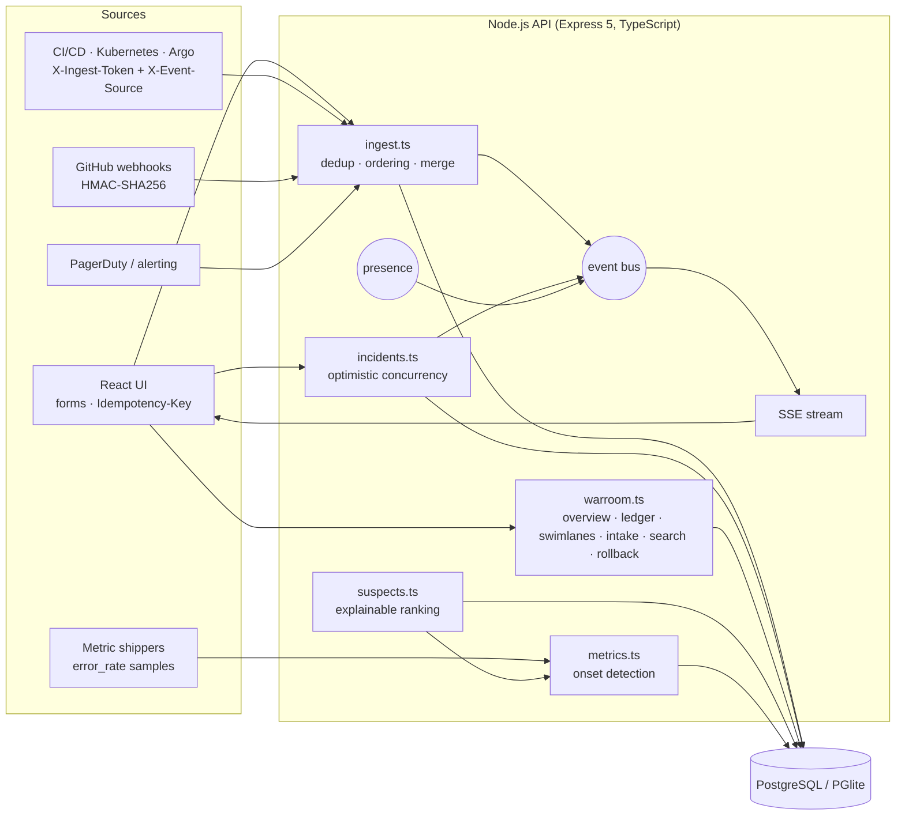
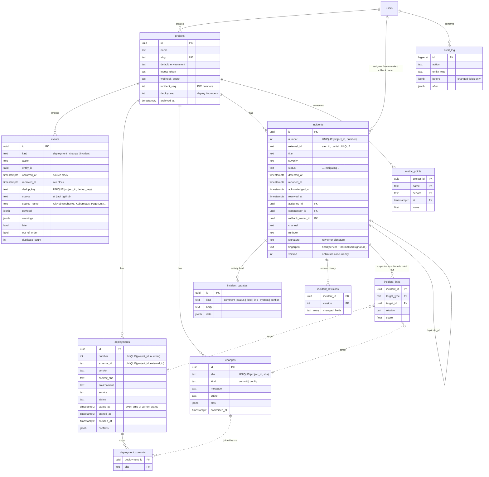
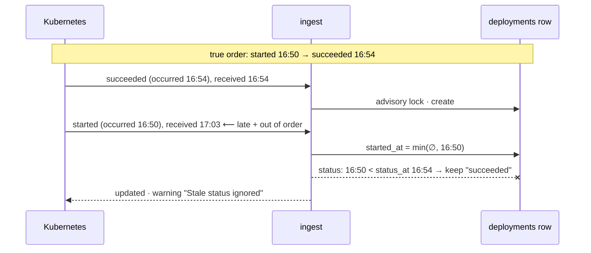
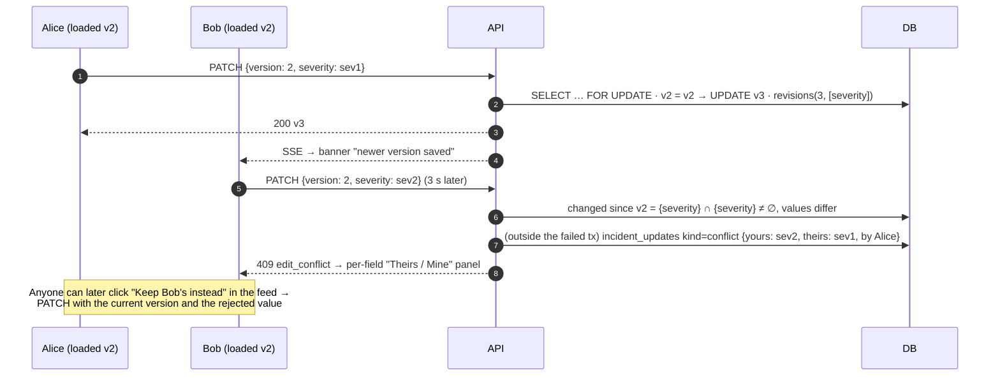
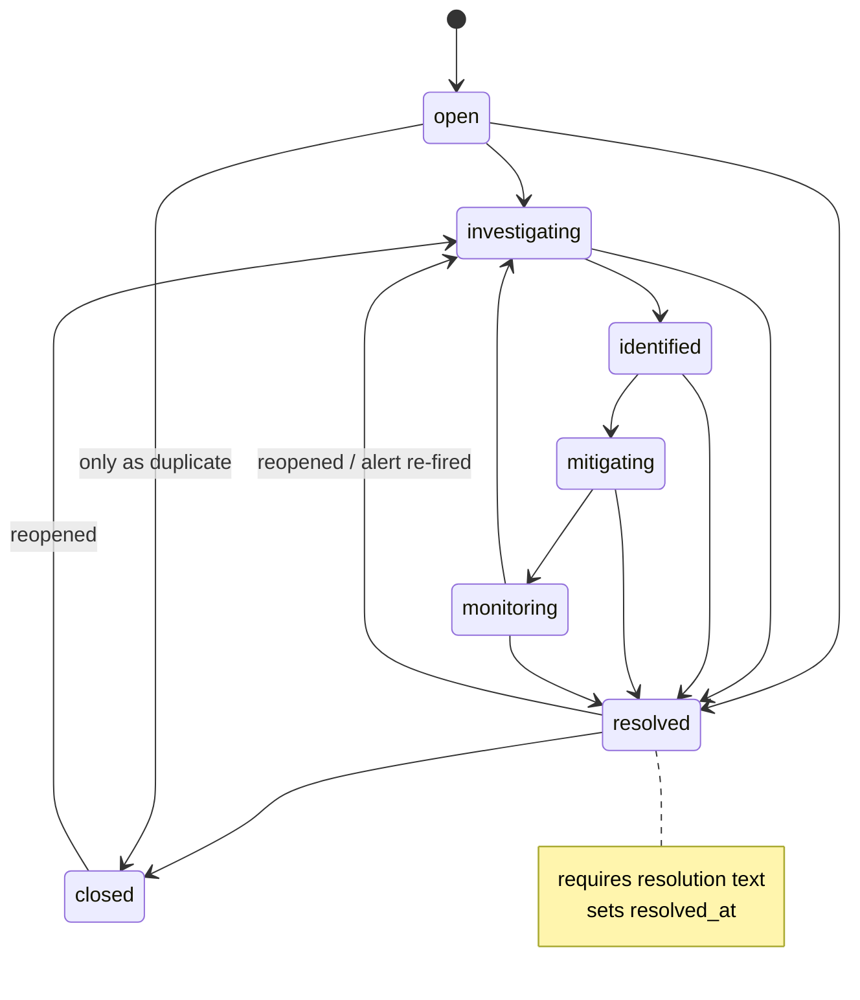

# bisect — architecture

This document covers the system design, the database schema and the main workflows. The diagrams are Mermaid, so GitHub renders them inline.

1. [System overview](#1-system-overview)
2. [Database schema](#2-database-schema)
3. [Workflow: ingesting an event](#3-workflow-ingesting-an-event)
4. [Workflow: merging out-of-order deploy events](#4-workflow-merging-out-of-order-deploy-events)
5. [Workflow: concurrent incident edits](#5-workflow-concurrent-incident-edits)
6. [Incident lifecycle](#6-incident-lifecycle)
7. [Finding what broke it](#7-finding-what-broke-it)
8. [Rollback requests](#8-rollback-requests)
9. [War-room read models](#9-war-room-read-models)
10. [Real-time: live updates and presence](#10-real-time-live-updates-and-presence)
11. [Security and access control](#11-security-and-access-control)

---

## 1. System overview



**One way in.** Every fact (deploy, commit, config change, incident) enters through `ingestEvents()`, whether it comes from a UI form, CI, GitHub or an alerting tool. Deduplication, late/out-of-order detection and conflict handling therefore exist once and apply to every source. The UI's "Record deploy" and "Report incident" use the same path, so a double-clicked button is deduplicated the same way a retried webhook is.

**Event log + materialised state.** `events` is an append-only log of what we were told, and when. `deployments`, `changes` and `incidents` hold what we currently believe, merged from that log.

**Derived, not stored, presentation.** The overview's sentences ("1 in 6 checkout requests are failing", "went live 4 min before the error rate first spiked", "clean · rollback target") are composed from facts at read time. Nothing presentational is stored.

**One deployable.** In production the API also serves the built React app. For development and tests the same SQL runs on PGlite, which is Postgres compiled to WASM and running in-process.

---

## 2. Database schema

Three forward-only migrations live in `server/src/db/migrations.ts`: `001_init`, `002_war_room` and `003_accounts` (session revocation).



| Choice | Why |
|---|---|
| `events.UNIQUE(project_id, dedup_key)` | The database enforces dedup, so two concurrent identical deliveries can't both get through. |
| `occurred_at` + `received_at` | The timeline sorts by when things happened. The difference between the two is how late the report was. |
| `deployment_commits` keyed by SHA | A deploy can list commits we haven't received yet. They join up when the commit arrives, with no backfill job. |
| `deployments.status_at` | Status is last-writer-wins by **event time**, not arrival. |
| `deployments.number` / `projects.deploy_seq` | People say "#2481", not a UUID. A number is assigned on first sighting under an advisory lock, so a lost insert race never burns one. |
| `changes.kind = 'config'` | Terraform, feature-flag and env-var changes often never get a deploy record. They are still suspects. |
| `incident_revisions.changed_fields` | Makes field-level merging of concurrent edits possible. |
| `incident_updates.kind = 'conflict'` | A rejected concurrent edit is still somebody's intent, so it is kept and can be adopted later. |
| `metric_points` PK `(project, name, service, at)` | Re-sending a sample overwrites it instead of duplicating it. |

---

## 3. Workflow: ingesting an event

```mermaid
sequenceDiagram
  autonumber
  participant S as Source
  participant API as POST /projects/:id/events
  participant DB as Postgres (one transaction per event)
  participant BUS as Bus → SSE

  S->>API: { type, event_id?, occurred_at?, … }  + X-Event-Source
  API->>API: validate (Zod) · reject > 1 h in the future
  API->>API: dedup_key = event_id ▸ Idempotency-Key ▸ sha256(content [+10-min bucket])
  API->>DB: INSERT INTO events … ON CONFLICT (project_id, dedup_key) DO UPDATE duplicate_count + 1
  alt already seen
    API-->>S: { status: "duplicate", entity_id }
  else new
    API->>DB: late = received − occurred > 5 min; out_of_order = a later event already recorded
    API->>DB: apply to entity (row lock, merge by event time), warnings, audit
    API->>BUS: event.recorded (+ incident.suspect if a late deploy explains an open incident)
    API-->>S: { status: "created" | "updated", late, out_of_order, warnings }
  end
```

Each event in a batch gets its own transaction, so one invalid event is reported as `rejected` without failing the rest.

---

## 4. Workflow: merging out-of-order deploy events

Example: Kubernetes retried a webhook, so deploy #2481's `succeeded` arrived **before** its `started`.



| Field | Rule |
|---|---|
| `status` | Last writer wins by `occurred_at` |
| `started_at` / `finished_at` | Earliest start, latest finish |
| `version`, `commit_sha`, `environment`, `service`, `deployed_by`, `url` | Fill if empty. A different later value is stored in `conflicts` and shown; a rejected `commit_sha` is not attached to the commit list. |
| `commits[]` | Union by SHA |
| A commit naming an unknown deploy | Creates a placeholder deploy that later events complete |

Alerts follow the same pattern. If the *resolve* event arrives before the *open* event, a resolved incident is created with a provisional detection time. The late open event then moves `detected_at` earlier and does not reopen the incident.

---

## 5. Workflow: concurrent incident edits



Different fields edited from the same base version merge (`merged: true`). Writing the value that is already stored is a no-op. The row lock serialises writers, and a test fires three truly simultaneous writers to show no update is lost.

---

## 6. Incident lifecycle



Any active state can move to any other active state. The first move out of `open` sets `acknowledged_at`, which feeds MTTA. A rollback request moves `open`, `investigating` or `identified` to `mitigating`.

---

## 7. Finding what broke it

`GET /incidents/:id/suspects` returns ranked **deploys**, ranked **changes**, and the **error signal**.

**Reference time = onset.** If `error_rate` samples exist for the incident's service, the onset is the first sample (from 2 h before detection) that exceeds `max(1%, 5 × baseline)`, where the baseline is the median of the preceding day. Otherwise the onset is the detection time. Ranking against the onset rather than detection stops a deploy that went live *after* errors began from being blamed just because the alert fired late.

| Deploy signal | Effect | Example reason |
|---|---|---|
| Recency to onset | `0.45 · e^(−Δh/6)` | "Went live 4 min before the error rate first spiked" |
| Rolling out at onset | 0.45 | "Was still rolling out when …" |
| Went live after onset | 0.45 × 0.3 | "…after the error rate first spiked — unlikely to have started it" |
| Latest of that service/env | +0.15 | "Most recent checkout deployment to production …" |
| Service match / mismatch | +0.15 / ×0.6 | "Deployed the affected service (checkout)" |
| Environment match / mismatch | +0.05 / ×0.25 | "Different environment (staging vs production)" |
| Failed / rolled back | +0.10 | |
| **File history** | +0.3 × `culprits / (shipped + 1)` when ≥ 0.4 | "Changes db/pool.go — 2 of 3 earlier deploys that shipped it caused this error (INC-100, INC-095)" |
| Keywords | +0.10 | 'Commits mention "checkout"' |

**File history** looks at earlier incidents with the same fingerprint that have a confirmed deploy cause, and at each file those deploys shipped. It counts how many deploys to the same environment shipped that file and how many of them were culprits. Laplace-style smoothing (`+1`) stops a file that rode along once from looking guilty.

**Change suspects.**
- A commit inside a suspect deploy (score ≥ 0.3, at least 2 commits) gets the deploy's score × 0.8 if it touches the risky file, × 0.6 if it mentions the symptom, × 0.4 otherwise.
- A change with **no deploy record** in the 24 h before onset is scored on its own: recency, +0.15 if it is a config change, keywords and file history.

**Human verdicts override everything.** Confirmed links rank first and ruled-out links last. "Not it → next" in the UI is just a ruled-out link.

**Rollback target.** This is the most recent earlier deploy of the same service and environment that `succeeded`, has no confirmed incident, and isn't itself a rollback.

---

## 8. Rollback requests

bisect does **not** run deployments. `POST /incidents/:id/rollback {from, target}`:

1. checks that the target is older than `from`, `succeeded`, and in the same project;
2. ingests a `pending` deployment of the target's version and commit, with the deterministic id `rollback:<from#>-><target#>:<INC>`. Asking twice is therefore a duplicate, not a second rollback;
3. writes a feed entry and moves the incident to `mitigating`.

The CD system picks up the request and reports progress against that id through the normal ingestion API, which flows through the same merge rules as any deploy. The ledger shows it as `deploying` until then.

---

## 9. War-room read models

| Endpoint | What it derives |
|---|---|
| `/projects/:id/overview` | Focus incident (worst severity, then newest active), active list, `max(received_at)` for data freshness, presence |
| `/projects/:id/ledger` | Last N deploys plus out-of-band changes in the same span, each with an **after** label: `caused INC-x` · `failed` · `rolled back` · `suspect in INC-x` · `deploying` · `clean · rollback target` · `soaking` (< 2 h) · `clean` · `no deploy record` |
| `/projects/:id/swimlanes` | Deploys, changes, incidents, reports and late/duplicate events, plus error-rate samples (bucket-max downsampled to ≤ 300 points) for a window |
| `/projects/:id/recurring` | Union-find clusters (same fingerprint, or same service with title Jaccard ≥ 0.5), each with its occurrences, median time to resolve, and confirmed causes by type |
| `/projects/:id/intake?since` | Events received, duplicates folded, late (and max delay), out of order, edit conflicts caught, plus the active policy |
| `/projects/:id/sources` | Per-integration `max(received_at)` and 24 h count |
| `/incidents/:id/feed` | Incident updates, plus late/duplicate plumbing events from the 6 h before detection. Other incidents' events are included only when they share the fingerprint or service. |
| `/search?q` | `INC-102` / `102`, `#2481`, version, external id, SHA prefix (≥ 4 hex), commit message, author, people, projects |

---

## 10. Real-time: live updates and presence

- **SSE** (`GET /api/stream?project_id`) carries `event.recorded`, `incident.updated`, `incident.comment`, `incident.suspect` and `presence`. The shell opens **one** stream per tab and fans messages out to the pages, which refetch with debouncing. The stream is closed on `pagehide`; without that, Chrome can keep old streams open across reloads and exhaust its HTTP/1.1 connection pool (6 per host).
- **Presence.** The incident page and the overview send a heartbeat every 20 s. Entries expire after 45 s. Changes are pushed as `presence` messages and drive "2 in INC-102" and "viewing now".
- Both the bus and presence are in-process, which suits a single API instance. Running replicas would need Postgres `LISTEN/NOTIFY` or Redis behind the same interfaces.

---

## 11. Security and access control

| Capability | viewer | engineer | admin |
|---|:-:|:-:|:-:|
| Read everything, live stream, search, presence | ✓ | ✓ | ✓ |
| Report / record, edit incidents, comment, verdicts, rollback requests | | ✓ | ✓ |
| Projects (create / edit / archive), secrets, users, audit log | | | ✓ |

- **Accounts.** There are no built-in accounts. On an empty database `POST /auth/setup` creates the owner (admin) once, serialised by an advisory lock; after that it returns 409. Admins add everyone else.
- **Sessions.** Passwords use scrypt; tokens are HMAC-signed and carry their issue time. The user and role are re-read on every request, so a demotion is immediate, and tokens issued before `users.password_changed_at` (a password change or admin reset) are rejected.
- **Sign-in.** Failures are rate-limited per IP and email (`LOGIN_MAX_ATTEMPTS` per `LOGIN_WINDOW_MINUTES`, then 429 with `Retry-After`). Unknown emails still pay the scrypt cost, so timing does not reveal which accounts exist.
- **Production.** The server refuses to start with `NODE_ENV=production` unless `AUTH_SECRET` is set and at least 32 characters. Responses carry a Content-Security-Policy (`script-src 'self'`, no inline scripts), `X-Frame-Options: DENY`, `nosniff`, a referrer policy and, in production, HSTS. `trust proxy` is opt-in (`TRUST_PROXY`).
- Machine clients use a per-project ingest token, which can only ingest events and metrics. GitHub requests are verified with HMAC-SHA256 over the raw body in constant time. Archived projects reject both.
- All input is validated with Zod. Malformed IDs return 404 instead of reaching SQL. Every mutation is audit-logged with a before/after diff of the changed fields only.
